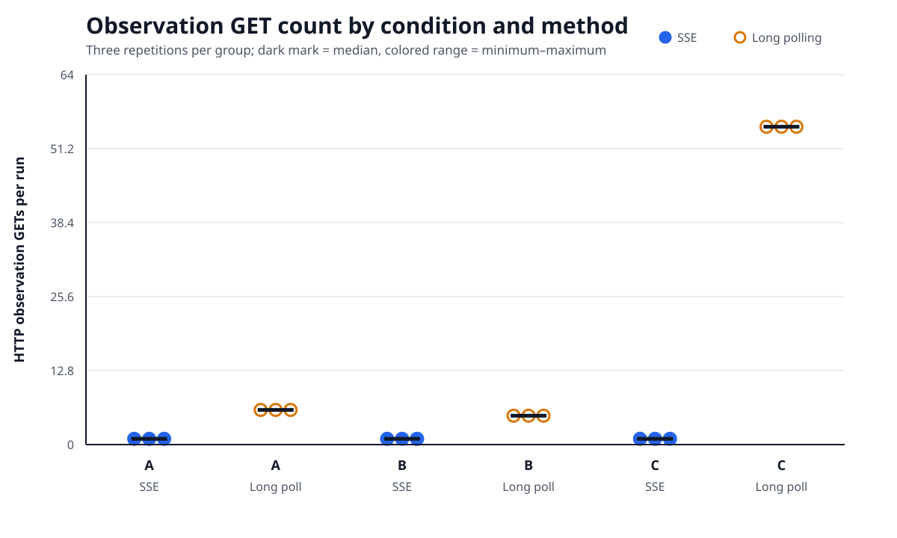
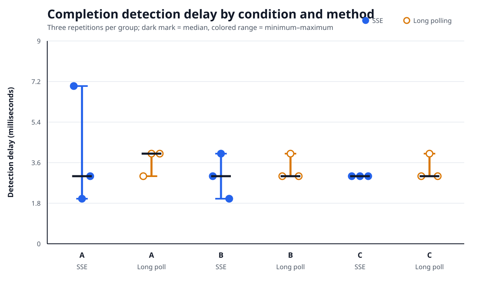

# SSE cuts observation requests while local completion delay stays comparable

## Executive summary

ImageLab Version 3 adds Server-Sent Events (SSE) without changing the durable upload and image-processing pipeline. PostgreSQL remains authoritative, and each SSE event contains a complete current job snapshot read after a committed change. The controlled experiment compared SSE with version-based long polling across 18 browser-observed runs.

- SSE used one observation GET in all nine runs. Long polling used a median of 6 GETs in the quiet condition, 5 during ordinary processing, and 55 during frequent 200 ms updates.
- Median terminal detection delay ranged from 3 to 4 ms for both methods. The complete observed range was 2–7 ms, so this local experiment does not establish a meaningful latency advantage for either method.
- SSE kept a handler open for the job duration and delivered 5 events in conditions A and B and 55 events in condition C. Fewer requests therefore do not prove lower total resource cost.
- SSE is the preferred default for this single-server ImageLab design because it expresses ongoing observation with one browser API object and avoids request churn as update frequency rises. Long polling remains a sound fallback when an open stream is undesirable or infrastructure support is uncertain.

## Predictions recorded before measurement

**Condition A, quiet interval.** SSE should use one stream GET and carry no job-update traffic during the 30-second quiet period apart from optional heartbeat comments. Long polling should reach its 20-second deadline and open another request before real processing starts. Terminal detection should be similar once the commit notification arrives.

**Condition B, real progress.** Both methods should expose processing, three stored-variant progress states, and completion. SSE should use one GET, while long polling should begin a new GET after each returned snapshot. Detection delay should remain close because both wait on the same post-commit notification hub.

**Condition C, frequent updates.** SSE should retain one stream while event traffic rises. Long polling should approach one GET per observed version. A local, unloaded client may observe every version, but snapshot semantics allow gaps if notifications coalesce or the observer falls behind.

## Method

The experiment used the same PNG (`docs/evidence/01-initial-state.png`), fixed thumbnail/preview/display transformations, one in-process worker, one active browser observer, and an empty queue at each run start. Each condition contained three repetitions per method. Method order alternated by repetition: SSE then long polling for repetition 1, long polling then SSE for repetition 2, and SSE then long polling for repetition 3.

- Condition A used `-job-delay=30s` with simulated progress disabled.
- Condition B used the ordinary worker configuration with no artificial phase.
- Condition C used `-simulation-interval=200ms -simulation-duration=10s`, followed by real processing.

A headless Chrome page executed the browser APIs and remained the only active experiment observer. Browser receipt time used `Date.now()` immediately after the terminal snapshot arrived. Detection delay equals that receipt time minus PostgreSQL's terminal timestamp. Processing duration equals terminal time minus `started_at`. Server logs record post-commit versions, database reads, heartbeat counts, stream duration, and peak active SSE handlers. Raw records and exact job IDs are preserved in [`raw/`](raw/), and [`runs.csv`](runs.csv) accounts for all 18 runs.

## Results

| Condition | Method | Observation GETs, median (min–max) | Detection ms, median (min–max) | Observation DB reads per run | Stream duration |
| --- | --- | ---: | ---: | ---: | ---: |
| A: quiet 30 s | SSE | 1 (1–1) | 3 (2–7) | 5 | 30.216–30.379 s |
| A: quiet 30 s | Long polling | 6 (6–6) | 4 (3–4) | 11 | n/a |
| B: real progress | SSE | 1 (1–1) | 3 (2–4) | 5 | 0.188–0.242 s |
| B: real progress | Long polling | 5 (5–5) | 3 (3–4) | 9 | n/a |
| C: 200 ms updates | SSE | 1 (1–1) | 3 (3–3) | 55 | 10.218–10.294 s |
| C: 200 ms updates | Long polling | 55 (55–55) | 3 (3–4) | 109 | n/a |

The full summary values are in [`summary.csv`](summary.csv).

The request graph makes the update-frequency effect visible. SSE stayed at one stream GET under every condition. Long polling required a new HTTP request after each returned snapshot, so its count rose from 5–6 in conditions A and B to 55 in condition C. The quiet condition also demonstrates the long-poll deadline: one `204 No Content` was followed by another observation request before processing resumed.

The delay graph shows substantial overlap. Every median was 3 or 4 ms, and the largest single delay was 7 ms. In this local single-client environment, post-commit notification and immediate database re-read dominated neither method enough to create a clear latency difference.

Every run began at version 1 and ended at version 5 for conditions A and B or version 55 for condition C. This unloaded local client observed every version, so recorded version gaps were zero. That result does not change the contract: notifications are signals to read the latest PostgreSQL snapshot, not a durable event history, and a slower client may skip intermediate versions.

## Interpretation and recommendation

SSE fits ImageLab's changing-state problem well. One `EventSource` opens a response, receives the immediate snapshot, and then parses named `job-update` frames until the terminal snapshot closes the stream. Reconnection opens a new GET for the same job and recovers current state without replaying history. Closing observation unregisters the handler but leaves the worker context and database job unchanged.

The request advantage grows with update frequency, but request count is only one part of observer work. Condition A kept each SSE handler open for about 30.3 seconds and sent two heartbeat comments. Condition C delivered 55 complete snapshot events and performed 55 observation database reads. The corresponding long-poll runs performed 109 reads because each notification-driven request registered, read, returned, and was followed by another request. These measurements cover one local observer and do not establish production capacity, TCP connection count, or total CPU/memory/network cost.

Use SSE as the default observation mode for the current single-process deployment. Keep long polling available as a compatible fallback and short polling as a baseline. Before any production-scale claim, test many concurrent observers through the intended proxy, measure handler memory and scheduler work, record response bytes, and include connection interruption/retry behavior.

## Limitations

The experiment ran on one computer with one observer, one worker, local PostgreSQL, local storage, and no network throttling. Headless Chrome avoids background-tab throttling but does not reproduce a user's network or proxy path. Three repetitions reveal consistency in this controlled setup but provide little statistical power. Browser and database timestamps came from the same host; cross-device clock skew would make the wall-clock detection calculation less reliable. Finally, the in-process notification hub supports one server process only and does not provide multi-server fan-out or durable replay.
